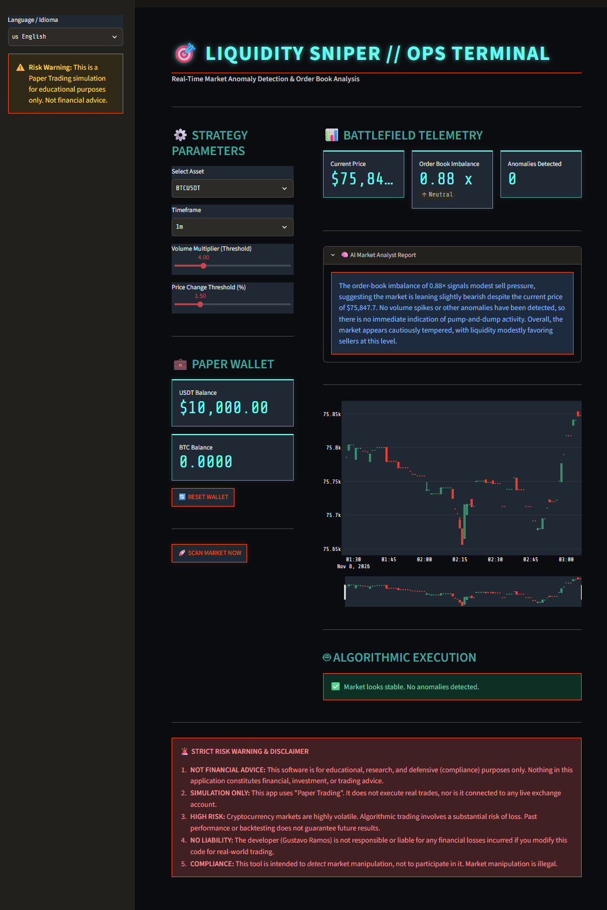
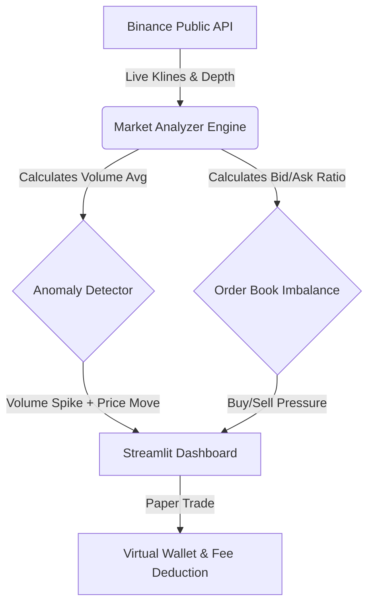

# 🎯 Liquidity Sniper: Algorithmic Market Anomaly Detector

[](https://liquidity-sniper-7pbplvdjl8edrykrvtsxy.streamlit.app)
[](https://liquidity-sniper-7pbplvdjl8edrykrvtsxy.streamlit.app)
[](https://www.python.org/)
[]()
[]()
[]() <!-- Cambiado a Public -->

An algorithmic trading dashboard designed to detect **Pump & Dump** patterns and market manipulation in real-time. 

This tool bridges the gap between Data Science and Financial Market Microstructure. It doesn't just look at price charts; it analyzes the **Order Book Imbalance** and simulates trade execution (including Binance's 0.1% taker fees) to test the profitability of the strategy.

## 🌐 Try It Live

🔴 **[Open the Interactive Dashboard Here](https://liquidity-sniper-7pbplvdjl8edrykrvtsxy.streamlit.app)**

No installation needed — just click and explore the tactical trading terminal in your browser. Available in English and Spanish.

## 📸 Ops Terminal Telemetry



## 🚨 The Problem & The Solution

- **The Problem:** Retail traders often fall victim to "Pump & Dump" schemes, where artificial volume spikes are used to manipulate the price before a massive sell-off. Traditional indicators (like Moving Averages) are too slow to react to these sudden micro-structural changes.
- **The Solution:** Liquidity Sniper uses a dual-layer approach:
  1. **Anomaly Detection:** Calculates the rolling average of volume and flags any sudden spikes combined with aggressive price changes.
  2. **Order Book Analysis:** Scrapes the live Binance Order Book (Bids vs. Asks) to calculate the "Imbalance Ratio". If there is a massive volume anomaly *and* the order book shows extreme buy pressure, it triggers a signal.

## 🧮 Quantitative Logic (The Math)

Unlike simple price-action bots, Liquidity Sniper calculates the **Order Book Imbalance (OBI)** using the top 50 levels of the Binance Depth Chart:

`OBI = Sum(Bid Volumes) / Sum(Ask Volumes)`

- If `OBI > 1.2`: Strong Buy Pressure (Bullish Imbalance).
- If `OBI < 0.8`: Strong Sell Pressure (Bearish Imbalance).

The algorithm only executes a trade if an anomaly is detected **AND** the OBI aligns with the momentum.

## 🧠 Core Features

1. **Real-Time Binance API Integration:** Fetches live Klines (candlesticks) and Order Book depth without requiring an API key.
2. **Algorithmic Execution (Paper Trading):** Includes a virtual wallet with $10,000 USDT. When a signal is triggered, it simulates buying/selling and deducts real Binance fees to show true net profit.
3. **Interactive Plotly Candlesticks:** Visualizes price action with tactical markers for detected anomalies.
4. **Bilingual UI (EN/ES):** Fully localized in English and Spanish for international trading teams.
5. **Corporate Cyberpunk UI:** A clean, dark-mode tactical dashboard built for professional traders, inspired by military operation terminals.

## 🛠️ Tech Stack
- **Core:** Python 3.12
- **Web Framework:** Streamlit
- **Data & Math:** Pandas, NumPy
- **Financial API:** `python-binance`
- **Visualization:** Plotly

## 🏗️ System Architecture

The tool is built with a modular architecture, separating market data extraction from the UI layer.



## 🚀 How to Run Locally

### Prerequisites
- Python 3.10+

### Installation
1. Clone the repository:
   ```bash
   git clone https://github.com/codewarrior777/liquidity-sniper.git
   cd liquidity-sniper
   ```

2. Create a virtual environment and install dependencies:
   ```bash
   python -m venv .venv
   .\.venv\Scripts\Activate.ps1  # Windows
   pip install -r requirements.txt
   ```

3. Run the dashboard:
   ```bash
   streamlit run app.py
   ```

## ⚠️ Disclaimer
This tool is for **educational and research purposes only**. It is a simulation (Paper Trading). It does not execute real trades on Binance. Do not use this as financial advice. 

---
*Built as a Data Science & Fintech Portfolio Project by Gustavo Ramos.*